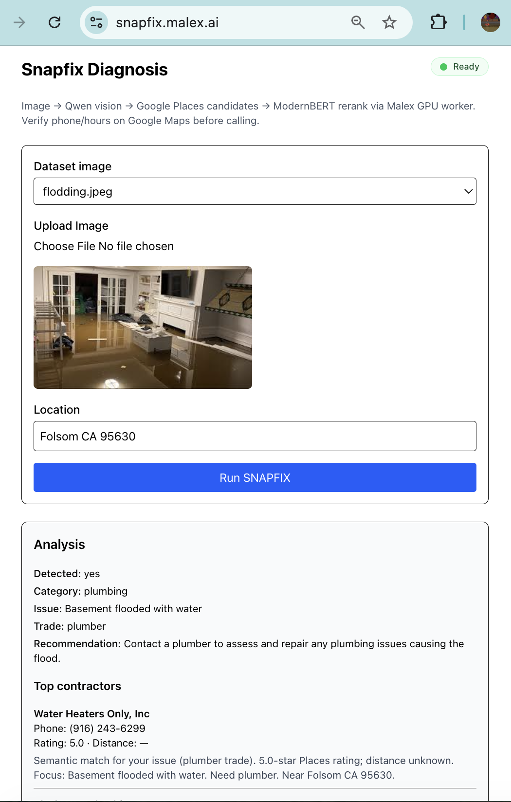

# SNAPFIX project

Standalone Next.js demo for the SNAPFIX home-maintenance pipeline (`POST /snapfix/contractors` on Malex Edge → GPU tenant app).

| Path | Purpose |
|------|---------|
| `src/app/` | Web UI (`npm run dev` / Cloudflare Pages) |
| `dataset/` | Training / test images |
| `doc/SNAPFIX_DESIGN.md` | Architecture and API notes |
| `scripts/setup_colab.sh` | Colab / own GPU: vLLM + Qwen2-VL + tenant server (no Malex) |
| `scripts/run_local_mac.sh` | Local Mac: Transformers + Qwen2-VL (no vLLM) |
| `scripts/prototype_vision.py` | Minimal HF model-card script for vision-only experiments |
| `scripts/test_snapfix.sh` | Edge smoke test (curl) |
| `server/snapfix_server.py` | SNAPFIX tenant HTTP app (contractors + rerank on GPU) |
| `.env` | Local secrets + config (never uploaded to R2; app secrets synced to Edge KV at deploy) |

**Model**
Let's use Qwen2-VL-7B-Instruct

https://huggingface.co/Qwen/Qwen2-VL-7B-Instruct


**Smoke Test**
```bash
source .env
python server/snapfix_server.py
```


```bash
curl -s http://127.0.0.1:8790/snapfix/contractors \
  -H 'Content-Type: application/json' \
  -d "$(python3 - <<'PY'
import base64, json, pathlib
p = pathlib.Path("dataset/broken-oven.jpeg")
b64 = base64.b64encode(p.read_bytes()).decode()
print(json.dumps({
    "image_base64": f"data:image/jpeg;base64,{b64}",
    "location": "Folsom CA 95630",
}))
PY
)" | python3 -m json.tool
```

**Deploy surfaces**

| Surface | Command | URL |
|---------|---------|-----|
| Full stack | `malexai run` | GPU bootstrap + Pages UI + custom domain (see below) |
| GPU + backend only | `malexai run --skip-pages` | Malex Edge proxies `/snapfix/*` to the worker |
| Web UI only | `npm run deploy` | [https://snapfix.malex.ai](https://snapfix.malex.ai) (or [snapfix.pages.dev](https://snapfix.pages.dev)) |

SSH on the GPU instance is for ML/runtime debugging (`server/`, vLLM logs). The Next.js app is **not** copied to the instance.

## Colab / own GPU (pre-Malex)

Run the full snapfix backend on your own GPU (Colab, Vast, local workstation) without `malexai run`:

1. **GPU runtime** — Colab: Runtime → Change runtime type → GPU (T4 may OOM; try L4/A100 or lower `VLLM_GPU_MEMORY_UTILIZATION`).
2. **Secrets** — `cp .env.example .env` and set **`GOOGLE_PLACES_API_KEY`** (required for contractor search after vision).
3. **Start stack** — installs deps from `pyproject.toml`, serves **Qwen2-VL** via vLLM on `:3001`, runs `server/snapfix_server.py` on `:8790`:

```bash
cd examples/snapfix
bash scripts/setup_colab.sh
```

Colab notebook:

```python
# %cd malexai-platform/examples/snapfix
# !bash scripts/setup_colab.sh
```

First run downloads ~16GB HuggingFace weights. Logs: `logs/vllm.log`, `logs/snapfix.log`.

```bash
source .env
source "../../scripts/dev-env.zsh"
```

For production deploy (R2, Edge proxy, Pages UI), use **`malexai run`** below.

## Local Mac prototyping (no vLLM)

For researchers iterating on vision before GPU deploy — uses [Qwen2-VL-7B-Instruct](https://huggingface.co/Qwen/Qwen2-VL-7B-Instruct) via **Hugging Face Transformers** (same pattern as the model card: `qwen-vl-utils`, `Qwen2VLForConditionalGeneration`, `process_vision_info`).

**Requirements:** Python 3.11+, ~16GB+ unified memory on Apple Silicon (MPS). First run downloads ~16GB weights.

### Vision-only (model card script)

```bash
cd examples/snapfix
pip install -e ".[local]"
python scripts/prototype_vision.py dataset/burst-pipe.jpeg
python scripts/prototype_vision.py --prompt "Is there a plumbing issue?" dataset/broken-sink.jpeg
```

### Full SNAPFIX backend locally

Installs deps, sets `SNAPFIX_VISION_BACKEND=transformers`, runs `server/snapfix_server.py` on `:8790`:

```bash
cd examples/snapfix
cp .env.example .env   # optional: GOOGLE_PLACES_API_KEY for contractor search
bash scripts/run_local_mac.sh
```

Smoke test (after model loads):

```bash
PIXELPNG_B64='iVBORw0KGgoAAAANSUhEUgAAAAEAAAABCAYAAAAfFcSJAAAADUlEQVR42mNk+M/wHwAFgwJ/lQGTWQAAAABJRU5ErkJggg=='
curl -s http://127.0.0.1:8790/snapfix/contractors \
  -H 'Content-Type: application/json' \
  -d "{\"image_base64\":\"data:image/png;base64,${PIXELPNG_B64}\",\"location\":\"Folsom CA 95630\"}" | python3 -m json.tool
```

**Dependency groups** in `pyproject.toml`:

| Extra | Install | Use |
|-------|---------|-----|
| `tenant` | `uv pip install -e ".[tenant]"` | Lightweight tenant deps on GPU boot (rerank, httpx) |
| `local` | `uv pip install -e ".[local]"` | Mac / notebook prototyping (Transformers + heavy stack) |

Production **`malexai run`** uses **`gpu-runtime`**: a public PyTorch CUDA image (or Malex profile fallback), R2 project sync, `uv pip install` for the vision stack on public bases, then `uv pip install -e ".[tenant]"` for lightweight deps — **no per-tenant Docker build**. On Malex profile images, `torch` / `transformers` / `qwen-vl-utils` are already in the image.


## Local uv development
Install uv on local Mac if it's not there yet:
```
brew install uv
```

```
uv venv .venv
source .venv/bin/activate
uv pip install -e .
```

### Start server
```
python server/snapfix_server.py
```


## Local Malexai development

### Malexai command
https://malex.ai/developers/cli
```bash
export MALEX_API_KEY=<tenant-key-from-dashboard>
curl -fsSL https://bootstrap.malex.ai/install-malexai.sh | bash
# installs to ~/.malexai/bin — add to PATH if needed:
# export PATH="$HOME/.malexai/bin:$PATH"
```

### Deploy GPU + backend

```bash
source ./.env
malexai run
```

After `malexai run`, Malex provisions a **new GPU instance** for the SNAPFIX tenant app (Qwen2-VL + Places + ModernBERT). Wait until the UI status shows **Ready**, then open the live test page:

**[https://snapfix.malex.ai/](https://snapfix.malex.ai/)**

Upload (or pick a dataset image), set a location, and click **Run SNAPFIX** to exercise the full pipeline.


