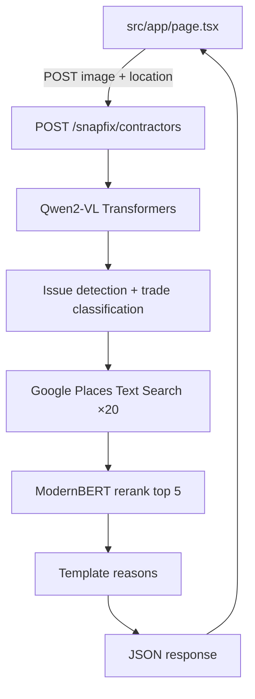

# SNAPFIX — Home Maintenance AI Detection System

## Overview

SNAPFIX is an AI-powered web application that detects home maintenance issues from user-uploaded photos and suggests nearby contractor services.

## Problem Statement

Users need to quickly identify what's broken in their homes and find qualified contractors to fix it. Currently, this requires:

- Cross-referencing multiple sources
- Guessing what might need repair
- Finding contractors manually

SNAPFIX automates this through multimodal vision and grounded local business search.

---

## Architecture

Single orchestrated backend endpoint. The browser does **not** call Google Places or run ranking; API keys stay on the GPU tenant / Malex Edge.



### Pipeline steps

| Step | Component | Responsibility |
|------|-----------|----------------|
| 1 | **Qwen2-VL** | Multimodal analysis: `detected`, `category`, `issue`, `trade`, `recommendation` |
| 2 | **Trade classification** | `trade` is a short search term (e.g. `plumber`, `electrician`) used for Places query |
| 3 | **Google Places API** | Geocode location, text search `${trade} ${issue} near ${location}`, return up to **20** candidates with phones |
| 4 | **ModernBERT rerank** | Bi-encoder similarity + hybrid score (rating, distance) → **top 5** |
| 5 | **Response** | Map picks to name, phone, rating, distance, template `reason` |

### Locked decisions

- **Business search**: Google Places API (New) + Geocoding.
- **Orchestration**: One endpoint `POST /snapfix/contractors` on the tenant HTTP server (`server/snapfix_server.py`); Malex Edge proxies `/snapfix/*`.
- **Vision**: In-process [Qwen2-VL-7B-Instruct](https://huggingface.co/Qwen/Qwen2-VL-7B-Instruct) via Hugging Face Transformers (`server/qwen_vision.py`).
- **Reranking**: ModernBERT (`answerdotai/ModernBERT-large` via `sentence-transformers`) — not an LLM for ordering (avoids hallucinated contractors).
- **`reason` field**: Template strings from score breakdown (rating + distance + issue/trade).

### Repo layout

| Path | Purpose |
|------|---------|
| `src/app/` | Next.js web UI |
| `server/snapfix_server.py` | Tenant HTTP app (contractors + rerank + health) |
| `server/qwen_vision.py` | Qwen2-VL image analysis |
| `dataset/` | Sample / test images |
| `scripts/` | Colab, local Mac, and smoke-test helpers |

---

## Vision prompt

Return JSON only:

```text
You are SNAPFIX. Analyze the image to determine if there is a home maintenance problem.
Return JSON only with exactly these keys:
- "detected": boolean
- "category": short string (e.g. "plumbing", "electrical", "roof", "hvac")
- "issue": brief problem description
- "trade": short search-friendly trade label (e.g. "plumber", "electrician", "roofer")
- "recommendation": one sentence for the homeowner

No markdown, no extra keys, no explanations.
```

User message also includes a residential location hint.

---

## Ranking

Used by ModernBERT (not an LLM prompt):

- **Query embedding**: `"{issue}. Need {trade}. Near {location}."`
- **Candidate embedding**: `"{name}. Trade: {trade}. Rating {rating}. Distance miles {distance}. {address}."`
- **Hybrid score**: `0.5 * normalize(cosine_sim) + 0.3 * normalize(rating) + 0.2 * normalize(1/distance)`

Fallback when rerank fails: sort by distance, then rating.

---

## API

Implemented in `server/snapfix_server.py`. Malex Edge proxies `/snapfix/*` to the GPU worker.

### `POST /snapfix/contractors`

**Request** (`application/json`):

```json
{
  "image_base64": "data:image/jpeg;base64,...",
  "location": "Folsom CA 95630"
}
```

**Response** (`application/json`):

```json
{
  "analysis": {
    "detected": true,
    "category": "plumbing",
    "issue": "corroded copper pipe",
    "trade": "plumber",
    "recommendation": "Licensed plumber for copper repipe/repair"
  },
  "contractors": [
    {
      "name": "Example Plumbing",
      "phone": "+1 916-555-0100",
      "rating": 4.8,
      "distance": "2.3 mi",
      "reason": "Semantic match for your issue (plumber trade). 4.8-star Places rating; 2.3 mi away. Focus: ..."
    }
  ],
  "search_warning": null
}
```

- Returns up to **5** contractors when Places returns enough results with phones; fewer otherwise with `search_warning`.
- If `detected` is false, skips Places and returns an empty contractor list.
- Cap `image_base64` payload at **6 MB** (`413` if larger).
- Optional `rerank_warning` when the hybrid rerank falls back to distance/rating sort.

### `POST /snapfix/rerank`

ModernBERT hybrid rerank (`query` + `trade` + `candidates[]` → ranked `scores` by `place_id`).

### `GET /snapfix/health`

Liveness: `{ "ok": true }`.

### Error behavior

| Failure | HTTP | Notes |
|---------|------|-------|
| Missing `image_base64` / `location` | 400 | |
| Payload too large | 413 | > 6 MB |
| Invalid vision JSON | 422 | No Places call |
| Vision runtime error | 502 | `vision_upstream_error` |
| Places API error | 502 | `places_error` |
| Missing `GOOGLE_PLACES_API_KEY` | 500 | `misconfigured` |
| Rerank failure | 200 | Still returns contractors via distance/rating fallback + `rerank_warning` |

### Secrets

Set in project `.env` (synced to Edge KV on `malexai run`):

- `GOOGLE_PLACES_API_KEY` — must allow **Places API (New)** (`places.googleapis.com`, `Places.SearchText`) **and** **Geocoding API** (`maps.googleapis.com`).
- `HF_TOKEN` — Hugging Face download auth when needed.
- `SNAPFIX_VISION_MODEL` — default `Qwen/Qwen2-VL-7B-Instruct`.
- `SNAPFIX_VISION_DEVICE` — `cuda` / `mps` / `cpu`.
- `SNAPFIX_RERANK_DEVICE` — default `cpu` (avoids contention with vision on MPS).

---

## Frontend

Page: [`src/app/page.tsx`](../src/app/page.tsx). Single-column mobile-friendly layout.

### Flow

1. **Input** — image upload (or pick from `dataset/` via `/dataset/manifest.json`), location text (default `Folsom CA 95630`), **Proceed**.
2. **Request** — `POST` via `getMalexSnapfixContractorsUrl()` in [`src/lib/malex-edge.ts`](../src/lib/malex-edge.ts). Production uses same-origin `/snapfix/contractors`; `next dev` uses `/malex-edge-proxy/` rewrites to `MALEX_EDGE_URL`.
3. **Display** — analysis fields; up to 5 contractors (`name`, `phone`, `rating`, `distance`, `reason`); `search_warning` / `rerank_warning` when present. GPU status via `MalexInstanceStatusPill`.

### Types

```typescript
type SnapfixAnalysis = {
  detected: boolean;
  category: string;
  issue: string;
  trade: string;
  recommendation: string;
};

type ContractorRow = {
  name: string;
  phone: string;
  rating: number;
  distance: string;
  reason: string;
};
```

---

## Dataset

Sample images live in [`dataset/`](../dataset/) (burst pipe, broken sink/oven, drywall cracks, flooding, wall dent, ants, etc.). Used for local smoke tests and the UI dataset picker — not for training a dedicated detector.

---

## Deploy & run surfaces

| Surface | How | Notes |
|---------|-----|-------|
| Full stack | `malexai run` | GPU bootstrap + Pages UI + Edge proxy |
| GPU + backend only | `malexai run --skip-pages` | Edge proxies `/snapfix/*` to the worker |
| Web UI only | `npm run deploy` | Cloudflare Pages (`snapfix.malex.ai`) |
| Own GPU / Colab | `scripts/setup_colab.sh` | Tenant server on `:8790` |
| Local Mac | `scripts/run_local_mac.sh` or `python server/snapfix_server.py` | Transformers + MPS/CPU |

See [README.md](../README.md) for commands and dependency extras (`tenant`, `local`).

---

## References

- [Qwen2-VL-7B-Instruct](https://huggingface.co/Qwen/Qwen2-VL-7B-Instruct)
- [ModernBERT](https://huggingface.co/answerdotai/ModernBERT-large)
- [Google Places API (New) — Text Search](https://developers.google.com/maps/documentation/places/web-service/text-search)
- [Malex CLI](https://malex.ai/developers/cli)
